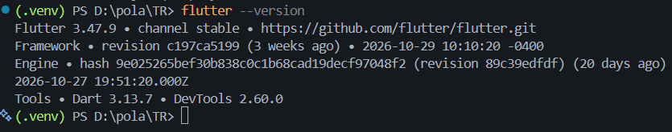
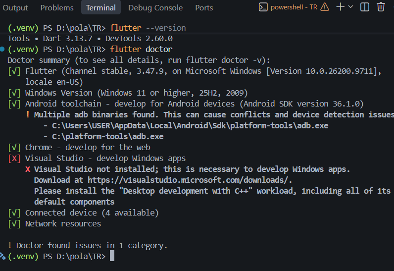
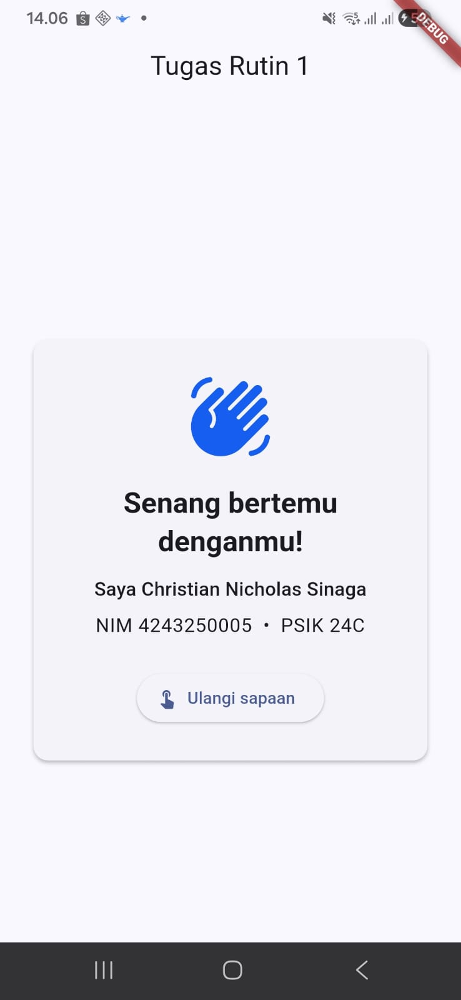

# Tugas Rutin 1 — Setup Environment & Hello World Flutter

**Nama:** Christian Nicholas Sinaga  
**NIM:** 4243250005  
**Kelas:** PSIK 24C

## Deskripsi

Aplikasi Flutter sederhana yang menampilkan Hello World dan identitas mahasiswa.
Ikon tangan melambai dan tombol **Sapa saya** menjadi widget tambahan. Tekan
tombol untuk mengubah sapaan; tekan lagi untuk mengembalikannya.

## Menjalankan aplikasi

Pastikan Flutter SDK sudah terpasang, lalu jalankan dari folder proyek:

```powershell
flutter pub get
flutter doctor -v
flutter devices
flutter run
```

Untuk menjalankan aplikasi di Chrome:

```powershell
flutter run -d chrome
```

Untuk menjalankan di HP Android melalui USB, aktifkan USB debugging, setujui
otorisasi pada HP, lalu pilih perangkat yang muncul di `flutter devices`:

```powershell
flutter devices
flutter run -d DEVICE_ID
```

Ganti `DEVICE_ID` dengan ID yang ditampilkan oleh `flutter devices`.

## Hasil verifikasi

### Keluaran `flutter --version`

```text
Flutter 3.47.9 • channel stable
Dart 3.13.7 • DevTools 2.60.0
```

### Ringkasan `flutter doctor`

```text
[✓] Flutter 3.47.9 (stable) • Windows 11
[✓] Android toolchain • Android SDK 36.1.0
[!] Multiple adb binaries found
[✓] Chrome
[X] Visual Studio not installed (untuk aplikasi desktop Windows)
[✓] Connected device (4 available)
[✓] Network resources
```

Perangkat Android yang terdeteksi adalah **SM A245F**, Android 16 (API 36),
terhubung melalui USB. Peringatan dua instalasi `adb` tidak mencegah perangkat
terdeteksi pada pemeriksaan ini. Visual Studio hanya diperlukan untuk target
desktop Windows, bukan Android atau web. Jika HP tidak muncul, periksa kabel
data, aktifkan USB debugging, setujui dialog otorisasi, lalu jalankan
`adb devices`. ID unik perangkat tidak dicantumkan di README.

Pemeriksaan aplikasi:

```powershell
flutter analyze
flutter test
flutter build web
flutter build apk --debug
```

Semua perintah pemeriksaan aplikasi di atas berhasil. APK debug dibuat di
`build/app/outputs/flutter-apk/app-debug.apk`.

## Bukti tangkapan layar

### Versi Flutter



### Pemeriksaan Flutter Doctor



### Aplikasi berjalan di HP Android



## Esai singkat: Native, Hybrid, dan Cross-platform

Pengembangan native membuat aplikasi secara khusus untuk satu sistem operasi,
misalnya Kotlin untuk Android atau Swift untuk iOS. Pendekatan ini memberi
akses paling langsung ke fitur perangkat dan biasanya cocok untuk aplikasi yang
membutuhkan performa tinggi. Kekurangannya, tim perlu mengembangkan dan merawat
implementasi terpisah untuk setiap platform.

Hybrid umumnya menggabungkan teknologi web seperti HTML, CSS, dan JavaScript
dengan pembungkus native. Cara ini memudahkan penggunaan kembali keterampilan
web, tetapi pengalaman pengguna dan akses ke kemampuan perangkat dapat
bergantung pada plugin atau jembatan ke kode native.

Cross-platform seperti Flutter menyediakan satu basis kode untuk menghasilkan
aplikasi di beberapa platform. Flutter menggambar antarmukanya sendiri melalui
widget, sehingga tampilan lebih konsisten dan pengembangan fitur bersama bisa
lebih cepat. Namun, pengembang tetap perlu menguji setiap target dan menulis
kode khusus platform ketika membutuhkan integrasi tertentu. Untuk tugas ini,
Flutter sesuai karena satu contoh kecil dapat berjalan di Android dan web,
sekaligus memperlihatkan struktur widget, tema, dan interaksi tombol. Pilihan
teknologi terbaik bergantung pada kebutuhan performa, fitur perangkat, waktu,
dan kemampuan tim.

## Repository GitHub publik

Nama repository yang diminta: `pm-pertemuan-01-4243250005` (**Public**).
Repository lokal ini memiliki riwayat commit bertahap. Setelah membuat
repository kosong dengan nama tersebut di GitHub, hubungkan dan unggah:

```powershell
git remote add origin https://github.com/<USERNAME>/pm-pertemuan-01-4243250005.git
git push -u origin main
```

**URL repository publik:** isi setelah repository dibuat dan berhasil di-push.
